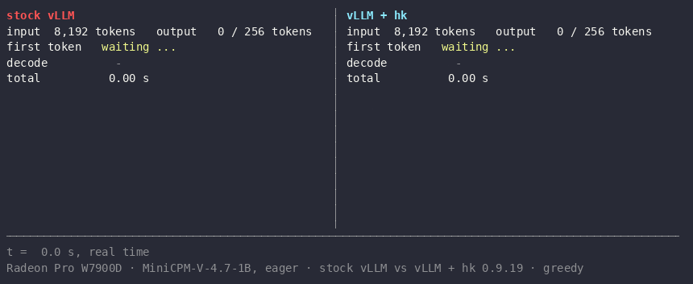
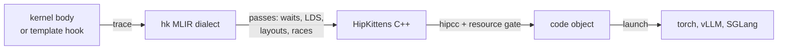

# hk-dsl

[](https://pypi.org/project/hk-dsl/)
[](https://github.com/vivienfanghuagood/hk-dsl/actions/workflows/ci.yml)
[](LICENSE)
[](https://vivienfanghuagood.github.io/hk-dsl/)

**Documentation: <https://vivienfanghuagood.github.io/hk-dsl/>**

**hk-dsl makes vLLM and SGLang faster on Radeon GPUs, and is the Python DSL
those kernels are written in.** Install it next to your engine and its
kernels replace the engine's where they measured faster, on the Radeon W7900 /
RX 7900 (RDNA3) and R9700 / RX 9070 (RDNA4). Or write your own AMD GPU kernels
in it, for RDNA and CDNA, with build-time checks against the errors that fail
silently (spills, missing waits, MFMA hazards).
[What it is and is not](docs/positioning.md).



*Radeon PRO W7900D, MiniCPM5-2B, one 32k-token prompt, vLLM without and with hk-dsl 0.9.18: first token after
11.8 s and after 4.4 s (2.71x) in this recording; both arms in one process, recorded one after the other and
played side by side at real speed, each request with its own ~32k-token document, so the prompts differ by a
few tokens ([how](tools/hk-bench/serving/readme_demo/README.md)). The number the project
quotes is the [scorecard](docs/performance/scorecard.md)'s, over rounds: TTFT at 32k 12,550 -> 4,247 ms, 2.95x
(hk 0.9.14).*

## Quick start

**Faster vLLM and SGLang on Radeon.** One command, in the environment that
runs your engine; hk's plugin loads by itself:

```bash
pip install hk-dsl && vllm serve Qwen/Qwen3-8B                       # vLLM
pip install hk-dsl && python3 -m sglang.launch_server --model-path Qwen/Qwen3-8B \
    --attention-backend triton --disable-cuda-graph                 # SGLang (W7900 / RX 7900)
```

The server's log then has a `[hk] vLLM routes on: ...` (or `[hk] SGLang routes
on: ...`) line per process. `HK_DISABLE=1` gives you the stock engine back.
No vLLM yet? On an R9700 one `docker run` does both: [hk in vLLM](docs/vllm.md#enable-hk-in-one-command). Each engine's page has the
GPUs and models, how to check it worked, and troubleshooting:
**[hk in vLLM](docs/vllm.md)** · **[hk in SGLang](docs/sglang.md)**.

**Your first kernel.** `pip install hk-dsl`, plus ROCm's hipcc and a ROCm
build of torch ([install](#install)). Write only the math; a template builds
the kernel:

```python
# my_kernels.py
import hk
from hk import templates as T

gelu_and_mul = T.elementwise(lambda g, u: hk.math.gelu(g) * u)  # the math of one element

@T.rowwise                                                       # the math of one row
def rms_norm(x, w, *, EPS=1e-6):
    return x * (T.row_mean(x * x) + EPS).rsqrt() * w

def bias_gelu(acc, ctx):                                         # fused into a GEMM's store
    acc += ctx.bias
    return hk.templates.gemm.gelu_tanh(acc)

def linear_bias_gelu(x, w, b):
    return hk.templates.gemm(x, w, epilogue=bias_gelu, bias=b)
```

```bash
python3 -m hk.check my_kernels.py:rms_norm \
    --ref "lambda x, w: x * torch.rsqrt((x * x).mean(-1, keepdim=True) + 1e-6) * w" \
    --inputs "bf16[4096,4096], bf16[4096]"
```

Call them with torch tensors, as `rms_norm(h, w)`. `hk.check` reports the
registers, occupancy and spills, the error against the reference, and the time
against torch eager and `torch.compile` on your GPU. It exits with 0 (pass),
1 (wrong) or 2 (error). Next:
[quickstart](docs/quickstart.md),
[templates](docs/templates/elementwise-rowwise.md),
[GEMM epilogues](docs/templates/gemm.md), [hk.check](docs/check.md).

## Where it runs

<!-- hw-table:begin -- generated by scripts/gen_hardware_docs.py from python/hk/target/*.py and switches.py; edit those and rerun it -->
| GPU | arch | level | engine routes on by default |
|---|---|---|---|
| Radeon PRO W7900, Radeon PRO W7900D, Radeon RX 7900 | gfx1100 (RDNA3) | tested | [18](docs/supported-hardware.md#engine-routes-on-each) |
| Radeon AI PRO R9700, Radeon RX 9070 | gfx1201 (RDNA4) | tested | [10](docs/supported-hardware.md#engine-routes-on-each) |
| Instinct MI300X, Instinct MI325X | gfx942 (CDNA3) | compile-only | [none](docs/supported-hardware.md#engine-routes-on-each) |
| Instinct MI355X, Instinct MI350X | gfx950 (CDNA4) | tested | [5](docs/supported-hardware.md#engine-routes-on-each) |

Tested: measured on the part and run by CI's GPU tier. What the language and each engine route do on each GPU: [supported hardware](docs/supported-hardware.md).
<!-- hw-table:end -->

- **Compilers (hipcc's clang):** clang 22 (ROCm 7.2.x) in CI's GPU tier;
  clang 23 (ROCm 10.0), tested on gfx950; clang 24 (ROCm 10.1) from 0.9.0,
  not in CI ([toolchains](docs/toolchains.md)).
- **Python:** wheels for CPython 3.10 to 3.13 ([install](#install)).

## What it is

hk-dsl has three layers:

- **The language** (`hk`, `hk.templates`, `hk.check`) is general. You control
  tiles in registers and LDS, matrix instructions and waits. hk-dsl lowers the
  kernel through its MLIR dialect to HipKittens C++ for hipcc. It catches
  spills, unwaited LDS reads and MFMA hazards at build time.
- **Kernels** (`hk.ops`) are written in the language. They show that it works,
  and they are how its gains reach a model.
- **Engine routes** (`hk.integration`) are thin adapters that send some of
  vLLM's and SGLang's calls to `hk.ops`.

## How it compares, and the numbers

[Triton](https://github.com/triton-lang/triton) is much cheaper to write: use
it unless you need control of tiles, LDS and waits.
[FlyDSL](https://github.com/ROCm/FlyDSL) gives similar control and is
CDNA-first. hk-dsl emits HipKittens C++, checks it at build time, and treats
RDNA3 and RDNA4 as first-class; it is not a faster code generator than that
C++ ([what it is and is not](docs/positioning.md)).

We quote only end-to-end serving results, from the
[scorecard](docs/performance/scorecard.md). On an Instinct MI355X,
DeepSeek-V4.1-Flash on vLLM (TP2), hk's default routes on top of AITER's tuned
paths give **about +5% on 8k-token prefill**, decode unchanged. Radeon
results come with the RDNA scorecard.

## Documentation

[What it is and is not](docs/positioning.md) ·
[getting started](docs/getting-started.md) ·
[templates](docs/templates/elementwise-rowwise.md) ·
[hk.check](docs/check.md) · [the language](docs/language.md) ·
[API](docs/api/README.md) · [hk in vLLM](docs/vllm.md) ·
[hk in SGLang](docs/sglang.md) ·
[scorecard](docs/performance/scorecard.md) · [every page](docs/README.md) ·
[changelog](CHANGELOG.md) · [docs site](https://vivienfanghuagood.github.io/hk-dsl/)

## The language, when you need control

```python
import hk

@hk.kernel(grid=lambda p: (p.o.rows * hk.cdiv(p.o.cols, p.CW), 1, 1))
def gelu_mul(a: hk.Tensor[hk.T], b: hk.Tensor[hk.T], o: hk.Tensor[hk.T], *, CW=512):   # hk.T: the call's dtype
    S = hk.RS(hk.fp32, 1, CW, 8)                  # a register strip: one row, 8 16-bit values (16 B) a lane
    per_row = hk.cdiv(o.cols, CW)
    row = hk.arch.block_idx.x // per_row
    c0 = (hk.arch.block_idx.x - row * per_row) * CW
    x = a.at[row, c0].load(S, bounded=True)       # bf16 / fp16 -> fp32 on the load; past the end reads 0
    x.gelu(into=x)                                # hk.math.gelu: the tanh form, fp32 only
    x *= b.at[row, c0].load(S, bounded=True)
    o.at[row, c0].store(x, bounded=True)          # fp32 -> the output's dtype on the store

print(gelu_mul.trace(T=hk.bf16).dump())   # the hk MLIR module for bf16 -- needs nothing
print(gelu_mul.source(T=hk.bf16))         # the HipKittens C++ -- needs nothing
print(gelu_mul.build(T=hk.bf16).report()) # hipcc and the resource gate -- no GPU
```

`python3 -m hk.check` checks and times it like any other kernel
([check](docs/check.md#the-loop)). More: [the language](docs/language.md),
[examples](docs/examples.md).

On gfx950 there is more:
- **`hk.comm`** hands work between workgroups, XCDs and GPUs
  ([hk.comm](docs/language.md#between-workgroups-xcds-and-gpus-hkcomm-gfx950),
  [design](docs/design/comm.md), [a task graph](examples/14_task_graph.py)).
- **Workgroup placement on XCDs** is a compiler pass
  ([placement](docs/placement.md), [an example](examples/15_placement.py)).
- **Strip ops** let a kernel match another implementation bit for bit
  ([strips](docs/language.md#strip-ops-for-a-megakernels-roles-gfx950)).



The passes refuse what fails silently: an MMA above its wait, a spill, a
slow operand layout, a copy racing a barrier ([the traps](docs/correctness-gates.md#the-traps)).

## Install

`pip install hk-dsl`, for CPython 3.10 to 3.13 on Linux x86_64 with glibc
2.35 or newer (Ubuntu 22.04 and later). The release is 0.9.18: one
`manylinux_2_35` wheel for each of cp310, cp311, cp312 and cp313, all built on
glibc 2.35. A wheel carries the HipKittens headers, so at run time it needs ROCm's hipcc
(on `PATH`, or `HK_HIPCC`) and, to launch, a ROCm build of torch (not a
dependency). Another CPython has no wheel: build from source.

Which ROCm and hipcc versions are tested, and which are known not to work, is
in [install](docs/install.md).

From source, with the HipKittens submodule:

```bash
git clone --recursive https://github.com/vivienfanghuagood/hk-dsl.git && cd hk-dsl
scripts/build_mlir.sh && scripts/build_hk_mlir.sh   # MLIR 23.1.3 (~20 min on 64 cores), then hk (~1 min)
export PYTHONPATH=$PWD/python
```

Details: [install](docs/install.md), [building](docs/building.md).

## In vLLM and SGLang

Installed, hk is on by default: the engine loads hk's plugin, which applies
every route that met [the default-on rule](docs/testing.md#the-default-on-rule)
on your GPU (at least 1.15x the engine's best kernel on a real model's shapes,
the correctness suite, and an end-to-end check), and sends a call to hk only
where hk measured faster. How to check it, the GPUs and models, and how to turn
it off: [hk in vLLM](docs/vllm.md), [hk in SGLang](docs/sglang.md). What each
route replaces: [vLLM routes](docs/vllm-routes.md),
[SGLang routes](docs/sglang-routes.md); every switch:
[integration](docs/integration.md).

## For coding agents

[llms.txt](llms.txt) (or [llms-full.txt](llms-full.txt), every doc in one
file), the [hk-kernel skill](skills/hk-kernel/SKILL.md), the generated
[API reference](docs/api/README.md), and `python3 -m hk.check FILE.py:NAME
--json -` as the loop's one command (`--arch gfx1100,gfx950` builds for the
GPU that is not in the machine).

## Contributing, license, acknowledgements

Issues and pull requests welcome: [CONTRIBUTING.md](CONTRIBUTING.md) (new kernels add no
kernel-specific helpers or one-off DSL ops; the reviewer checklist), [testing](docs/testing.md),
[how numbers are taken](docs/performance/method.md). MIT
([LICENSE](LICENSE)). hk-dsl began in a fork of
[HipKittens](https://github.com/HazyResearch/HipKittens) (HazyResearch),
whose headers stay under its MIT License ([NOTICE](NOTICE)) and which brings
[ThunderKittens](https://github.com/HazyResearch/ThunderKittens)' tiles to
AMD GPUs. The control-flow rewrite follows CUTLASS's CuTe DSL.
