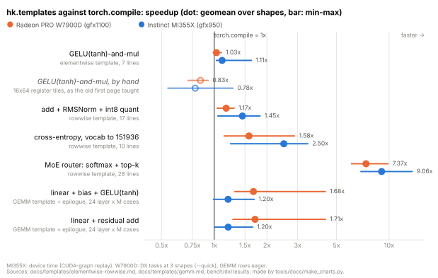
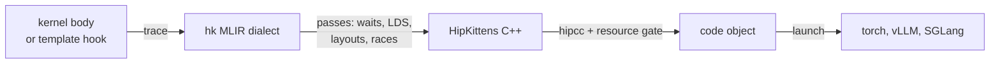

# hk-dsl

[](https://pypi.org/project/hk-dsl/)
[](https://github.com/vivienfanghuagood/hk-dsl/actions/workflows/ci.yml)
[](LICENSE)

**Fast AMD GPU kernels in a few lines of Python.** Write the math of an
element, a row or a GEMM epilogue; hk-dsl turns it into a tuned kernel for
the Radeon (gfx1100) or Instinct (gfx950) GPU you are on. For full control,
write the kernel in [HipKittens](https://github.com/HazyResearch/HipKittens)'
tiles. Either way it is traced into an MLIR dialect whose passes refuse
silent failures, translated to HipKittens C++, compiled by hipcc and called
from torch. `python -m hk.check` says whether it is right and whether it
beats `torch.compile`.

## Quick start

`pip install hk-dsl` (ROCm's hipcc and a ROCm torch [besides](#install)), then
save a file:

```python
# my_kernels.py
import hk
from hk import templates as T

gelu_and_mul = T.elementwise(lambda g, u: hk.math.gelu(g) * u)  # the math of one element

@T.rowwise                                                       # the math of one row
def rms_norm(x, w, *, EPS=1e-6):
    return x * (T.row_mean(x * x) + EPS).rsqrt() * w

def bias_gelu(acc, ctx):                                         # traced into a tuned GEMM's store
    acc += ctx.bias
    return hk.templates.gemm.gelu_tanh(acc)

def linear_bias_gelu(x, w, b):
    return hk.templates.gemm(x, w, epilogue=bias_gelu, bias=b)
```

call it with torch tensors:

```python
import torch
from my_kernels import gelu_and_mul, rms_norm, linear_bias_gelu

x = torch.randn(4096, 2 * 14336, device="cuda", dtype=torch.bfloat16)  # a gate/up output
h = torch.randn(4096, 4096, device="cuda", dtype=torch.bfloat16)
w = torch.randn(4096, device="cuda", dtype=torch.bfloat16)
W = torch.randn(12288, 4096, device="cuda", dtype=torch.bfloat16) / 64
b = torch.randn(12288, device="cuda", dtype=torch.bfloat16)

y = gelu_and_mul(x[:, :14336], x[:, 14336:])  # the two halves, read in place
n = rms_norm(h, w)
z = linear_bias_gelu(h, W, b)                  # F.gelu(F.linear(h, W, b), approximate="tanh")
```

and check a kernel against torch:

```bash
python -m hk.check my_kernels.py:rms_norm \
    --ref "lambda x, w: x * torch.rsqrt((x * x).mean(-1, keepdim=True) + 1e-6) * w" \
    --inputs "bf16[4096,4096], bf16[4096]"
```

`hk.check` reports registers, occupancy and spills, the error against the
reference, and the time against torch eager and `torch.compile`; it exits 0
(pass), 1 (wrong) or 2 (error). Each block runs as shown on a W7900D and an
MI355X. Guides:
[elementwise/rowwise](docs/templates/elementwise-rowwise.md),
[GEMM epilogues](docs/templates/gemm.md), [hk.check](docs/check.md).

## Results at a glance

<picture>
  <source media="(prefers-color-scheme: dark)" srcset="docs/assets/templates-vs-torch-compile-dark.svg">
  
</picture>

Hollow: the same op by hand on 16x64 tiles, the slow way. The
[chart's script](tools/docs/make_charts.py) reads the committed tables.

| | Radeon PRO W7900D (gfx1100) | Instinct MI355X (gfx950) |
|---|---|---|
| [templates](docs/templates/elementwise-rowwise.md#measured) against hk's tuned kernel for the same job | 0.92-1.02x | 0.98-1.03x |
| [GEMM + epilogue](docs/templates/gemm.md#what-it-costs-measured) against `torch.compile` | faster at 48 of 48 layer shapes, geomean 1.69x | faster at 46 of 48, level at 2 |
| vLLM, Qwen3-8B, per request against stock ([A1](docs/performance.md#vllm-031-on-gfx1100), [B1](docs/performance.md#b1-end-to-end-in-vllm-aiter-on)) | 1.22-1.85x at 1-32 requests (vLLM 0.31.0, torch 2.13.0+rocm7.2, triton-rocm 3.7.1) | 1.13x at 16, 1.21x at 64 |
| bf16 GEMM against the field ([A2](docs/performance.md#a2-kernels-against-the-tuned-field), [B2](docs/performance.md#b2-kernels-against-the-tuned-field)) | ties FlyDSL, 1.28-1.39x hipBLASLt | 0.9x or better of the best at all 122 LLM shapes |
| where it loses ([A4](docs/performance.md#a4-losses-and-limits), [B4](docs/performance.md#b4-losses-and-no-headroom-findings)) | paged decode 0.86-1.12x Triton's | GEMMs 0.79-1.21x aiter's, norms 0.74-1.05x, MoE 0.66-0.94x CK's |

One GPU of each; every comparison interleaved in one process.
[Performance](docs/performance.md) has the method, the software stack of
every table and every loss.

## The language, when you need control

```python
import hk

@hk.kernel(grid=lambda p: (p.o.rows * hk.cdiv(p.o.cols, p.CW), 1, 1))
def gelu_mul(a: hk.Tensor[hk.bf16], b: hk.Tensor[hk.bf16], o: hk.Tensor[hk.bf16], *, CW=512):
    S = hk.RS(hk.fp32, 1, CW, 8)                  # a register strip: one row, 8 bf16 (16 B) a lane
    per_row = hk.cdiv(o.cols, CW)
    row = hk.arch.block_idx.x // per_row
    c0 = (hk.arch.block_idx.x - row * per_row) * CW
    x = a.at[row, c0].load(S, bounded=True)       # bf16 -> fp32 on the load; past the end reads 0
    x.gelu(into=x)                                # hk.math.gelu: the tanh form, fp32 only
    x *= b.at[row, c0].load(S, bounded=True)
    o.at[row, c0].store(x, bounded=True)          # fp32 -> bf16 on the store

print(gelu_mul.trace().dump())      # the hk MLIR module -- needs nothing
print(gelu_mul.source())            # the HipKittens C++ -- needs nothing
print(gelu_mul.build().report())    # hipcc and the resource gate -- no GPU
```

It ties `torch.compile` on an MI355X ([check](docs/check.md#the-loop)).
More: [the language](docs/language.md), [examples](examples/README.md).



The passes refuse what fails silently: an MMA above its wait, a spill, a
slow operand layout, a copy racing a barrier ([the traps](docs/README.md#the-traps)).

## Where it runs

| GPU | arch | status |
|---|---|---|
| Radeon PRO W7900 / W7900D, RX 7900 | gfx1100, RDNA3 | primary: every kernel, template and engine patch |
| Instinct MI355X | gfx950, CDNA4 | every kernel and template; vLLM end to end ([CDNA](docs/design/cdna.md)) |
| Radeon RX 9070 / Instinct MI300X | gfx1201 / gfx942 | compile-only, no templates |

## Install

`pip install hk-dsl`, for CPython 3.10 (glibc 2.35+) or 3.12 (glibc 2.38+) on
Linux x86_64. The release is 0.6.0; it carries the HipKittens headers, so at
run time only hipcc is needed, and a ROCm build of torch (not a dependency)
to launch. From source, with the HipKittens submodule:

```bash
git clone --recursive https://github.com/vivienfanghuagood/hk-dsl.git && cd hk-dsl
scripts/build_mlir.sh && scripts/build_hk_mlir.sh   # MLIR 23.1.3 (~20 min on 64 cores), then hk (~1 min)
export PYTHONPATH=$PWD/python
```

Details: [getting started](docs/getting-started.md#install), [building](docs/building.md).

## In vLLM and SGLang

**hk is on by default.** Installed, hk's vLLM and SGLang plugins apply every
route that was validated with real weights on your GPU: its outputs were
bit-identical to the engine's, or its error was within the engine's own noise.
On an MI355X that is K1 and K2 for DeepSeek-V4.1. On a W7900D it is linear,
MoE, AWQ and attention. Each route sends a shape to hk's kernel only where hk
measured faster ([integration](docs/integration.md#on-by-default-and-turning-it-off)).
Turning it off is for comparisons:

```bash
vllm serve Qwen/Qwen3-8B                         # hk on: the routes validated on this GPU
HK_DISABLE=1 vllm serve Qwen/Qwen3-8B            # stock vLLM: nothing patched
HK_VLLM_GEMM=0 vllm serve Qwen/Qwen3-8B          # one route off (HK_<ROUTE>=0)
python3 -m hk.integration --status               # which routes are on, and why
```

If the installed engine does not match the contract the routes were
measured against, hk patches nothing and prints one warning line.
ConvRot INT8 is lossy, so it stays opt-in (`HK_SGLD=attn,linear,convrot`).

## For coding agents

[llms.txt](llms.txt) (or [llms-full.txt](llms-full.txt), every doc in one
file), the [hk-kernel skill](skills/hk-kernel/SKILL.md), the generated
[API reference](docs/api/README.md), and `python -m hk.check FILE.py:NAME
--json -` as the loop's one command (`--arch gfx1100,gfx950` builds for the
GPU that is not in the machine).

## Documentation

[Getting started](docs/getting-started.md) ·
[templates](docs/templates/elementwise-rowwise.md) ·
[hk.check](docs/check.md) · [the language](docs/language.md) ·
[API](docs/api/README.md) · [performance](docs/performance.md) ·
[everything, and why hk-dsl exists](docs/README.md) ·
[changelog](CHANGELOG.md)

## Contributing, license, acknowledgements

Issues and pull requests welcome: [testing](docs/testing.md),
[how numbers are taken](docs/performance.md#how-the-numbers-are-taken). MIT
([LICENSE](LICENSE)). hk-dsl began in a fork of
[HipKittens](https://github.com/HazyResearch/HipKittens) (HazyResearch),
whose headers stay under its MIT License ([NOTICE](NOTICE)) and which brings
[ThunderKittens](https://github.com/HazyResearch/ThunderKittens)' tiles to
AMD GPUs. The control-flow rewrite follows CUTLASS's CuTe DSL.
