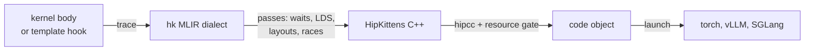

# hk-dsl

[](https://pypi.org/project/hk-dsl/)
[](https://github.com/vivienfanghuagood/hk-dsl/actions/workflows/ci.yml)
[](LICENSE)

**hk-dsl is a general-purpose Python DSL for AMD GPU kernels on RDNA and CDNA,
with build-time gates against silent tile-level errors (spills, missing waits,
MFMA hazards).** Today its largest end-to-end gains are on Radeon (RDNA3 and
RDNA4), where its kernels plug into vLLM and SGLang.
[What it is and is not](docs/positioning.md).

It has three layers:

- **The language** (`hk`, `hk.templates`, `hk.check`) is general. You control
  tiles in registers and LDS, matrix instructions and waits. hk-dsl lowers the
  kernel through its MLIR dialect to HipKittens C++ for hipcc. It catches
  spills, unwaited LDS reads and MFMA hazards at build time.
- **Kernels** (`hk.ops`) are written in the language. They show that it works,
  and they are how its gains reach a model.
- **Engine routes** (`hk.integration`) are thin adapters that send some of
  vLLM's and SGLang's calls to `hk.ops`.

> **Installed next to vLLM or SGLang, hk's routes are on by default.** The
> engine loads hk's plugin, which turns on the routes checked on your GPU.
> `python3 -m hk.integration --status` lists them, and `HK_DISABLE=1` turns
> them all off ([details](#in-vllm-and-sglang)).

## Where it runs

<!-- hw-table:begin -- generated by scripts/gen_hardware_docs.py from python/hk/target/*.py and switches.py; edit those and rerun it -->
| GPU | arch | level | engine routes on by default |
|---|---|---|---|
| Radeon PRO W7900, Radeon PRO W7900D, Radeon RX 7900 | gfx1100 (RDNA3) | tested | [10](docs/supported-hardware.md#engine-routes-on-each) |
| Radeon AI PRO R9700, Radeon RX 9070 | gfx1201 (RDNA4) | tested | [3](docs/supported-hardware.md#engine-routes-on-each) |
| Instinct MI300X, Instinct MI325X | gfx942 (CDNA3) | compile-only | [none](docs/supported-hardware.md#engine-routes-on-each) |
| Instinct MI355X, Instinct MI350X | gfx950 (CDNA4) | tested | [5](docs/supported-hardware.md#engine-routes-on-each) |

Tested: measured on the part and run by CI's GPU tier. What the language and each engine route do on each GPU: [supported hardware](docs/supported-hardware.md).
<!-- hw-table:end -->

- **Compilers (hipcc's clang):** clang 22 (ROCm 7.2.x) in CI's GPU tier;
  clang 23 (ROCm 10.0), tested on gfx950; clang 24 (ROCm 10.1), main after
  0.8.0 only. **Known issue:** with clang 24 on gfx1100, some kernels spill and
  are refused ([#140](https://github.com/vivienfanghuagood/hk-dsl/pull/140)).
- **Python:** wheels for CPython 3.10 and 3.12 ([install](#install)).

## Quick start

```bash
pip install hk-dsl      # plus ROCm's hipcc and a ROCm build of torch: see Install
```

```python
# my_kernels.py
import hk
from hk import templates as T

gelu_and_mul = T.elementwise(lambda g, u: hk.math.gelu(g) * u)  # the math of one element

@T.rowwise                                                       # the math of one row
def rms_norm(x, w, *, EPS=1e-6):
    return x * (T.row_mean(x * x) + EPS).rsqrt() * w

def bias_gelu(acc, ctx):                                         # fused into a GEMM's store
    acc += ctx.bias
    return hk.templates.gemm.gelu_tanh(acc)

def linear_bias_gelu(x, w, b):
    return hk.templates.gemm(x, w, epilogue=bias_gelu, bias=b)
```

```bash
python3 -m hk.check my_kernels.py:rms_norm \
    --ref "lambda x, w: x * torch.rsqrt((x * x).mean(-1, keepdim=True) + 1e-6) * w" \
    --inputs "bf16[4096,4096], bf16[4096]"
```

Call them with torch tensors, as `rms_norm(h, w)`. `hk.check` reports the
registers, occupancy and spills, the error against the reference, and the time
against torch eager and `torch.compile` on your GPU. It exits with 0 (pass),
1 (wrong) or 2 (error). Next:
[getting started](docs/getting-started.md),
[templates](docs/templates/elementwise-rowwise.md),
[GEMM epilogues](docs/templates/gemm.md), [hk.check](docs/check.md).

## Performance

We quote only end-to-end serving results from the
[scorecard](docs/performance/scorecard.md).

- **Instinct MI355X**, DeepSeek-V4.1-Flash on vLLM (TP2): hk's default routes on
  top of a stock vLLM that already uses AITER's tuned paths give **about +5% on
  8k-token prefill**. Decode is unchanged.
- **Radeon:** RDNA end-to-end results will come with the RDNA scorecard.

## How it compares

- **[Triton](https://github.com/triton-lang/triton)** is compiler-managed and
  much cheaper to write, on CDNA and RDNA. Use it unless you need control of
  tiles, LDS and waits.
- **[FlyDSL](https://github.com/ROCm/FlyDSL)** is AMD's MLIR Python DSL with
  instruction-level control. It is CDNA-first and used by AITER and vLLM.
- **hk-dsl** gives tile- and instruction-level control and emits HipKittens C++.
  Its gates check the result at build time, and RDNA3 and RDNA4 are
  first-class targets. It is not a faster code generator than that C++
  ([comparison](docs/positioning.md#how-it-compares)).

## Documentation

[What it is and is not](docs/positioning.md) ·
[getting started](docs/getting-started.md) ·
[templates](docs/templates/elementwise-rowwise.md) ·
[hk.check](docs/check.md) · [the language](docs/language.md) ·
[API](docs/api/README.md) · [vLLM and SGLang](docs/integration.md) ·
[scorecard](docs/performance/scorecard.md) · [every page](docs/README.md) ·
[changelog](CHANGELOG.md) · [docs site](https://vivienfanghuagood.github.io/hk-dsl/)

## The language, when you need control

```python
import hk

@hk.kernel(grid=lambda p: (p.o.rows * hk.cdiv(p.o.cols, p.CW), 1, 1))
def gelu_mul(a: hk.Tensor[hk.bf16], b: hk.Tensor[hk.bf16], o: hk.Tensor[hk.bf16], *, CW=512):
    S = hk.RS(hk.fp32, 1, CW, 8)                  # a register strip: one row, 8 bf16 (16 B) a lane
    per_row = hk.cdiv(o.cols, CW)
    row = hk.arch.block_idx.x // per_row
    c0 = (hk.arch.block_idx.x - row * per_row) * CW
    x = a.at[row, c0].load(S, bounded=True)       # bf16 -> fp32 on the load; past the end reads 0
    x.gelu(into=x)                                # hk.math.gelu: the tanh form, fp32 only
    x *= b.at[row, c0].load(S, bounded=True)
    o.at[row, c0].store(x, bounded=True)          # fp32 -> bf16 on the store

print(gelu_mul.trace().dump())      # the hk MLIR module -- needs nothing
print(gelu_mul.source())            # the HipKittens C++ -- needs nothing
print(gelu_mul.build().report())    # hipcc and the resource gate -- no GPU
```

`python3 -m hk.check` checks and times it like any other kernel
([check](docs/check.md#the-loop)). More: [the language](docs/language.md),
[examples](examples/README.md).

On gfx950 there is more:
- **`hk.comm`** hands work between workgroups, XCDs and GPUs
  ([hk.comm](docs/language.md#between-workgroups-xcds-and-gpus-hkcomm-gfx950),
  [design](docs/design/comm.md), [a task graph](examples/14_task_graph.py)).
- **Workgroup placement on XCDs** is a compiler pass
  ([placement](docs/placement.md), [an example](examples/15_placement.py)).
- **Strip ops** let a kernel match another implementation bit for bit
  ([strips](docs/language.md#strip-ops-for-a-megakernels-roles-gfx950)).



The passes refuse what fails silently: an MMA above its wait, a spill, a
slow operand layout, a copy racing a barrier ([the traps](docs/README.md#the-traps)).

## Install

`pip install hk-dsl`, for CPython 3.10 or 3.12 on Linux x86_64 with glibc
2.35 or newer (Ubuntu 22.04 and later). The release is 0.8.0: one
`manylinux_2_35` wheel for cp310 and one for cp312, both built on glibc 2.35. A
wheel carries the HipKittens headers, so at run time it needs ROCm's hipcc
(on `PATH`, or `HK_HIPCC`) and, to launch, a ROCm build of torch (not a
dependency). Another CPython 3.x (3.11, 3.13) has no wheel: build from source.

Which ROCm and hipcc versions are tested, and which are known not to work, is
in [getting started](docs/getting-started.md#install).

From source, with the HipKittens submodule:

```bash
git clone --recursive https://github.com/vivienfanghuagood/hk-dsl.git && cd hk-dsl
scripts/build_mlir.sh && scripts/build_hk_mlir.sh   # MLIR 23.1.3 (~20 min on 64 cores), then hk (~1 min)
export PYTHONPATH=$PWD/python
```

Details: [getting started](docs/getting-started.md#install), [building](docs/building.md).

## In vLLM and SGLang

**hk is on by default.** Once installed, hk's vLLM and SGLang plugins apply
every route that was validated with real weights on your GPU. A route is
validated when its outputs were bit-identical to the engine's, or its error was
within the engine's own noise. Which routes are on for each GPU is the
generated [route table](docs/supported-hardware.md#engine-routes-on-each)
(from the switches hk reads, so it cannot drift from them);
`python3 -m hk.integration --status` prints the decision on your machine.
SGLang-Diffusion's routes need `python3 -m hk.integration sglang-diffusion install`
once.

Each route sends a shape to hk's kernel only where hk measured faster
([integration](docs/integration.md#on-by-default-and-turning-it-off)). Turn
it off for comparisons:

```bash
vllm serve Qwen/Qwen3-8B                         # hk on: the routes validated on this GPU
HK_DISABLE=1 vllm serve Qwen/Qwen3-8B            # stock vLLM: nothing patched
HK_VLLM_GEMM=0 vllm serve Qwen/Qwen3-8B          # one route off (HK_<ROUTE>=0)
python3 -m hk.integration --status               # which routes are on, and why
```

If the installed engine does not match the contract the routes were
measured against, hk patches nothing and prints one warning line.
ConvRot INT8 is lossy, so it stays opt-in (`HK_SGLD=attn,linear,convrot`).

## For coding agents

[llms.txt](llms.txt) (or [llms-full.txt](llms-full.txt), every doc in one
file), the [hk-kernel skill](skills/hk-kernel/SKILL.md), the generated
[API reference](docs/api/README.md), and `python3 -m hk.check FILE.py:NAME
--json -` as the loop's one command (`--arch gfx1100,gfx950` builds for the
GPU that is not in the machine).

## Contributing, license, acknowledgements

Issues and pull requests welcome: [CONTRIBUTING.md](CONTRIBUTING.md) (new kernels add no
kernel-specific helpers or one-off DSL ops; the reviewer checklist), [testing](docs/testing.md),
[how numbers are taken](docs/performance.md#how-the-numbers-are-taken). MIT
([LICENSE](LICENSE)). hk-dsl began in a fork of
[HipKittens](https://github.com/HazyResearch/HipKittens) (HazyResearch),
whose headers stay under its MIT License ([NOTICE](NOTICE)) and which brings
[ThunderKittens](https://github.com/HazyResearch/ThunderKittens)' tiles to
AMD GPUs. The control-flow rewrite follows CUTLASS's CuTe DSL.
