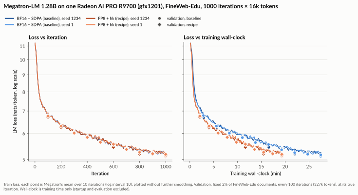

# hk in Megatron-LM training on RDNA4 (gfx1201)

hk speeds up FP8 training with Megatron-LM and Transformer Engine on the Radeon AI PRO R9700 / RX 9070 (gfx1201). A
1.28B Llama-style model trains **1.43x faster** than BF16 with PyTorch's SDPA, with every stock option tuned on both
sides. hk replaces two kernels of the step; the rest is configuration. Megatron's and TE's sources are not changed:
one launcher installs hk's pieces, then runs `pretrain_gpt.py`.

| what | how | switch |
|---|---|---|
| attention, forward and backward | `hk.ops.attn_bwd.attention`, in place of TE's unfused attention (gfx1201 has no fused one) | `HK_MEGATRON_ATTN=1` |
| the MLP's fc1 backward (FP8) | SwiGLU backward and the fp8 cast as one kernel (`hk.ops.fp8_cast`), then fc1's dgrad and wgrad on hk's fp8 GEMM | `HK_MEGATRON_FC1_BWD=1` |
| the output layer's weight gradient | TE's GEMM instead of apex's (configuration) | `HK_MEGATRON_LMHEAD_WGRAD=1` |
| cross-entropy | TE's fused kernel (configuration), with `--cross-entropy-loss-fusion` | `HK_MEGATRON_TE_CE=1` |

Each switch is off until set. `HK_MEGATRON_ATTN=sdpa` puts torch's SDPA in Megatron's core attention instead: that is
the baseline arm. `HK_PATCH_MEGATRON=0` turns every route off.

## Result

One R9700, Megatron-LM ROCm fork 5933b58, real text (FineWeb-Edu). 60 iterations an arm, in the order baseline,
recipe, recipe, baseline, all in one session. `tools/megatron-rdna4/run.sh`.

| | ms / iteration | TFLOP/s | peak memory |
|---|---:|---:|---:|
| **baseline**: BF16, torch SDPA attention, tuned GEMMs, LM-head fix, fused cross-entropy | 1631.9 (1633.6 / 1630.1) | 75.0 | 29.0 GB |
| **recipe**: FP8 (delayed, hybrid), hk attention, hk fc1 backward, tuned GEMMs, LM-head fix, fused cross-entropy | 1141.1 (1141.9 / 1140.2) | 107.2 | 29.8 GB |
| | **1.43x** | | |

No NaN in either arm. Where the 491 ms went, from a profile of each arm (ms an iteration):

| | baseline | recipe |
|---|---:|---:|
| GEMMs | 977 | 587 (hipBLASLt 413, hk's fc1 174) |
| attention | 367 | 150 |
| fp8 casts | 0 | 122 (TE 53, hk's fused SwiGLU backward 69) |
| elementwise | 160 | 150 |
| optimizer | 51 | 55 |
| RMSNorm / rope / cross-entropy | 33 / 15 / 12 | 32 / 15 / 12 |
| GPU idle | 21 | 22 |

**Loss.** Each change was trained 6 seeds x 200 iterations on real text, paired against the same configuration without
it. A placebo arm (no change but the GEMM algorithms) shows how far any rounding change moves the loss.

| change | loss difference, iterations 151-200 (mean, SE) | placebo |
|---|---:|---:|
| hk fc1 backward | -0.006 (0.006) | |
| LM-head weight gradient on TE | -0.0004 (0.004) | +-0.004 to 0.014 |
| TE fused cross-entropy | -0.004 (0.003) | |

All three are inside the placebo's range. The attention backward was checked per kernel against float64 and SDPA
(`tests/hk/gpu/test_attn_bwd.py`), and in training against SDPA.

**Convergence.** Both arms trained 1000 iterations (16.4M tokens) on 2 seeds. Validation used a fixed 2% of the
FineWeb-Edu documents, every 100 iterations.



| arm | seed | train loss (last 50 iterations) | validation loss @1000 | ms / iteration | tokens/s | minutes |
|---|---|---:|---:|---:|---:|---:|
| BF16 + SDPA | 1234 | 5.2422 | 5.1537 | 1636.5 | 10012 | 27.5 |
| BF16 + SDPA | 1 | 5.2553 | 5.1675 | 1640.7 | 9986 | 27.4 |
| FP8 + hk | 1234 | 5.2399 | 5.1555 | 1146.7 | 14288 | 19.3 |
| FP8 + hk | 1 | 5.2653 | 5.1851 | 1146.3 | 14293 | 19.3 |

- **Validation loss, recipe minus baseline, same seed:** +0.002 and +0.018. Within an arm, the two seeds differ by
  0.014 (baseline) and 0.030 (recipe), so this run shows no difference beyond seed noise.
- **Training:** both arms reach each training loss at the same iteration (+-30), and the recipe gets there 1.41-1.42x
  sooner in wall-clock. No NaN, skipped iteration or loss spike in either arm.

## Requirements

- A gfx1201 GPU, ROCm 7.2.x and PyTorch 2.10 for ROCm. The numbers above come from
  `rocm/pytorch:rocm7.2.4_ubuntu24.04_py3.12_pytorch_release_2.10.0`.
- **Transformer Engine for ROCm, built with gfx1201 enabled.** Stock ROCm Transformer Engine does not enable gfx1201
  yet. Branch `rdna4-fp8` of [AMD-AIM/TransformerEngine](https://github.com/AMD-AIM/TransformerEngine) does: it is
  ROCm TE c692b13 plus two patches. One enables FP8/BF16 on gfx120x; the other builds the PyTorch extension against
  torch 2.10. See "Build Transformer Engine" below.
- Megatron-LM, ROCm fork, commit 5933b58. No source changes. Branch `te-ce-version-gate` of
  [AMD-AIM/Megatron-LM](https://github.com/AMD-AIM/Megatron-LM) (5933b58 plus upstream's TE-version check for the
  fused cross-entropy) lets you pass `--cross-entropy-fusion-impl te` directly instead of `HK_MEGATRON_TE_CE=1`.
- hk-dsl with `hk.integration.megatron`.

## Build Transformer Engine

Inside the image above, about 40 minutes with 48 jobs:

```bash
git clone --recursive -b rdna4-fp8 https://github.com/AMD-AIM/TransformerEngine
cd TransformerEngine
python -m venv --system-site-packages te-venv && . te-venv/bin/activate   # if the image's environment is read-only
pip install cmake ninja pybind11 "setuptools<80" wheel pydantic importlib-metadata einops onnx onnxscript
NVTE_ROCM_ARCH=gfx1201 NVTE_FUSED_ATTN=0 NVTE_FUSED_ATTN_CK=0 NVTE_FUSED_ATTN_AOTRITON=0 \
NVTE_FRAMEWORK=pytorch NVTE_USE_ROCM=1 MAX_JOBS=48 \
    pip wheel --no-build-isolation --no-deps -w dist .
pip install --no-deps dist/transformer_engine-*.whl
```

TE's fused attention is left out (`NVTE_FUSED_ATTN=0`): it has no gfx120x kernels, and hk's or SDPA's attention takes
its place.

## Run

```bash
export MEGATRON=/path/to/Megatron-LM DATA=/path/to/dataset_text_document   # without DATA: --mock-data
export HIP_VISIBLE_DEVICES=0
tools/megatron-rdna4/run.sh tune-bf16     # once per model and shape: hipBLASLt + TunableOp searches (12 iterations)
tools/megatron-rdna4/run.sh tune-fp8
tools/megatron-rdna4/run.sh baseline      # 60 iterations
tools/megatron-rdna4/run.sh recipe
```

`python3 -m hk.integration --status` lists the routes and whether each is on.

**Check that the tuning loaded.** After `tune-*`, `$OUT/te_algos_{bf16,fp8}.csv` and `$OUT/tunableop_{bf16,fp8}0.csv`
must exist and be non-empty. Their row counts depend on which hk switches are on, because GEMMs that hk runs never
reach TE. A measured run's log has one `Loading autotune results from ...` line.

**The flags** (from `run.sh`; the recipe arm adds the FP8 line):

```
--num-layers 16 --hidden-size 2048 --num-attention-heads 16 --ffn-hidden-size 8192 --seq-length 2048
--max-position-embeddings 2048 --normalization RMSNorm --swiglu --position-embedding-type rope
--untie-embeddings-and-output-weights --disable-bias-linear --init-method-std 0.02
--tokenizer-type NullTokenizer --vocab-size 50303
--micro-batch-size 2 --global-batch-size 8 --lr 3e-4 --min-lr 3e-5 --lr-decay-style cosine --lr-warmup-iters 30
--weight-decay 0.1 --clip-grad 1.0 --adam-beta1 0.9 --adam-beta2 0.95 --bf16 --attention-dropout 0 --hidden-dropout 0
--transformer-impl transformer_engine --attention-backend unfused
--cross-entropy-loss-fusion --cross-entropy-fusion-impl native
--fp8-format hybrid --fp8-recipe delayed --fp8-amax-history-len 1024 --fp8-amax-compute-algo max
--keep-fp8-weight-transpose-cache-te                                                     # recipe only
```

The environment is `NVTE_FUSED_ATTN=0 NVTE_FLASH_ATTN=0` (TE has no fused attention for gfx120x),
`PYTORCH_TUNABLEOP_ENABLED=1`, `PYTORCH_ALLOC_CONF=expandable_segments:True` and `CUDA_DEVICE_MAX_CONNECTIONS=1`.
Micro-batch 2 with no activation recompute fits because hk's attention stores little.

## What each piece does, and its limits

- **Attention.** Supports causal or unmasked self-attention without dropout, bf16, head_dim 64 or 128, and GQA.
  - Megatron's SBHD tensors are read in place at micro-batch 1.
  - It does not support context parallelism, attention bias or packed sequences. A model that needs one of these
    stops with an error naming the switch.
  - The backward is deterministic.
  - Its measured ceiling, and what was not pursued: `tools/attn-bwd-gfx1201/README.md`.
- **fc1 backward.** Requires FP8 with delayed scaling, SwiGLU and `--disable-bias-linear`.
  - The fp8 gradient is written with padded rows. On gfx1201, rows a power of two of bytes apart share a memory
    channel, which halves the GEMMs that read them.
  - Only hk's GEMM reads that buffer; every other GEMM stays on TE, and a padded tensor headed for TE raises.
- **Cross-entropy.** `HK_MEGATRON_TE_CE=1` puts TE's fused kernel in the slot `native` names, because the ROCm fork
  refuses `--cross-entropy-fusion-impl te` outright. It needs TE 2.19 or later.
  - With a Megatron that gates that check on the TE version, as upstream Megatron-LM does, pass
    `--cross-entropy-fusion-impl te` and drop the switch. That means AMD-AIM/Megatron-LM's `te-ce-version-gate`
    branch, or ROCm/Megatron-LM's rocm_dev from the merge of
    [#169](https://github.com/ROCm/Megatron-LM/pull/169) on (2026-11-20, d3886b1). The switch stays until a released
    ROCm Megatron-LM contains the fix.
- **Not covered:**
  - one GPU only: tensor and pipeline parallelism were not run;
  - MXFP8 and current scaling;
  - gfx1100;
  - models that do not fit 32 GB: the 1.28B model at micro-batch 2 uses 29-30 GB.

## Measured and not taken

- **An hk cross-entropy kernel.** hk has one (two passes over the bf16 logits, fp32 log-sum-exp and gradient, the
  target entry's gradient in fp32; branch `claude/a-fused-ce`, not shipped). Against fp64, on one R9700 at
  (4096 x 50304), fwd+bwd:

  | | loss rel. error | grad rel. L2 | target grads zeroed (p_t 0.998-0.99999) | ms |
  |---|---|---|---|---|
  | Megatron, unfused (`vocab_parallel_cross_entropy`) | 7.8e-8 | 1.7e-3 | 0 | 19.9 |
  | Transformer Engine 2.21, fused | 7.4e-8 | 1.7e-3 | 0 | 5.08 |
  | hk | 7.4e-8 | 1.7e-3 | 0 | 4.31 |

  TE's fused kernel is already close to the bandwidth floor (about 2 ms), and hk would save about 3 ms an
  iteration, so the recipe uses TE's. Megatron-LM rejects TE's fused cross-entropy as unstable ("stability
  issues"). That covers TE before 2.19, which kept the gradient in bf16 and zeroed a near-certain target's
  (TransformerEngine #3193); 2.21 passes the same test.
  - How the recipe selects it: `HK_MEGATRON_TE_CE=1` puts TE's kernel in the slot `native` names. It refuses a TE
    older than 2.19.
  - When the fork gates the check on the TE version, as upstream Megatron-LM does (#7339), pass
    `--cross-entropy-fusion-impl te` and drop the switch. The fix is merged into ROCm/Megatron-LM rocm_dev
    ([#169](https://github.com/ROCm/Megatron-LM/pull/169)).
- **Attention backward beyond today's.** Measured ceiling and the levers left: `tools/attn-bwd-gfx1201/README.md`.
